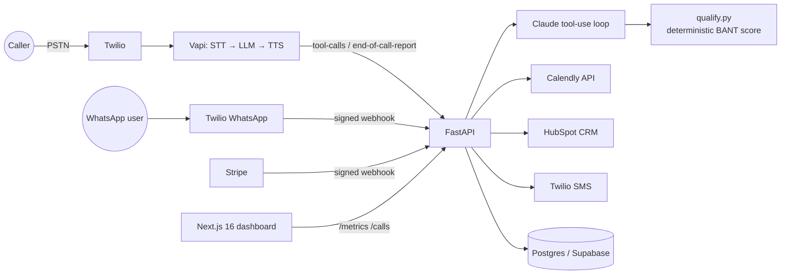

# AI Voice Operator

**An AI receptionist that answers phone calls and WhatsApp messages, qualifies leads, books meetings in Calendly and logs everything in HubSpot, at a fraction of the cost of a human SDR.**

> 🔴 **Live demo:** `https://<your-app>.vercel.app` · **Call it:** `+1 (XXX) XXX-XXXX` · **WhatsApp:** `+1 (XXX) XXX-XXXX`
> 🎥 **3-min walkthrough:** `https://loom.com/share/<id>`


---

## Results

Every number below comes from `GET /metrics`, which reads the `calls` and `tool_events` tables. Make real calls and run the load test, then paste in what the endpoint returns. **Never hand-edit these numbers.**

| Metric | Live (real phones) | Load test (`api/scripts/simulate_calls.py`) |
|---|---|---|
| Conversations handled | `__` | `__` |
| Avg cost per call (Vapi-reported `cost`) | `$__` | n/a (no real billing) |
| Human SDR cost per call (assumption below) | $7.00 | $7.00 |
| Cost reduction | `__%` | n/a |
| Tool round-trip latency p50 / p95 | `__ms / __ms` | `__ms / __ms` |
| Voice turn latency p50 (Vapi call analytics) | `__s` | n/a |
| Lead → booked meeting rate | `__%` | `__%` |

**How the human baseline is calculated:** a $28/hr loaded SDR cost × 15 min per inbound lead (talk time + CRM entry + scheduling) = $7.00. You can change it with `HUMAN_COST_PER_CALL`.

---

## What it does

1. **Answers.** An inbound call hits a Twilio number routed through Vapi (STT → LLM → TTS). A WhatsApp message hits the Twilio WhatsApp webhook.
2. **Qualifies.** The LLM pulls out BANT signals (budget, authority, need, timeline) and calls `qualify_lead`. **The LLM extracts and deterministic code decides:** [`qualify.py`](api/app/agent/qualify.py) scores the lead 0–100 and is unit-tested.
3. **Books.** Qualified leads get real open slots from the Calendly API. A single-use booking link goes out by SMS for voice callers or in the chat for WhatsApp.
4. **Logs.** Every lead is upserted into HubSpot (search by phone, then create or patch) with `hs_lead_status` mapped from the pipeline state.
5. **Bills.** The business owner subscribes through Stripe Checkout, and the webhook syncs subscription status.
6. **Reports.** A Next.js 16 dashboard shows volume, cost per call, latency, booking rate and recent calls (phone numbers masked).

## Architecture



```
ai-voice-operator/
├── docker-compose.yml
├── supabase/migrations/001_init.sql
├── api/                      FastAPI
│   ├── app/
│   │   ├── main.py
│   │   ├── config.py · db.py
│   │   ├── agent/            prompts · tools (shared registry) · chat (WhatsApp loop) · qualify (scoring)
│   │   ├── integrations/     calendly · hubspot · twilio_client
│   │   └── routes/           vapi · whatsapp · metrics · billing
│   ├── scripts/simulate_calls.py
│   └── tests/test_qualify.py
└── web/                      Next.js 16 dashboard
```

### Design decisions

| Decision | Why |
|---|---|
| LLM extracts signals and code scores them | Qualification is auditable and testable, and a prompt change can't change who gets booked. |
| One tool registry for voice and WhatsApp | Same business logic on both channels. `GET /vapi/assistant-config` generates the Vapi config from it. |
| Booking link by **SMS** for voice callers | WhatsApp only allows business-initiated messages outside the 24h window through approved templates. SMS has no such limit. |
| Idempotent `end-of-call-report` (`on conflict (external_id) do nothing`) | Vapi retries webhooks, so a retry can't create a duplicate call. |
| Twilio signature validation, Vapi shared secret, Stripe signature check | All webhooks are public URLs, so unsigned requests are rejected. |
| Tool errors are returned to the model, not raised | A failed HubSpot call doesn't hang up on a customer. |
| Load-test calls are prefixed `sim-` and skip HubSpot and SMS | They never pollute the CRM, text fake numbers or mix with live metrics. |
| Every integration runs in demo mode without keys | `docker-compose up` works with no accounts. |

## Run it

```bash
cp .env.example .env            # optional; runs in demo mode with no keys
docker-compose up --build
# dashboard → http://localhost:3000    API docs → http://localhost:8000/docs

docker-compose exec api python -m scripts.simulate_calls --n 800
docker-compose exec api pytest -q
```

### Try it by hand (be Vapi yourself)

Send the same webhook Vapi sends during a call. Use a call id starting with `sim-`, otherwise your test counts as a live call (and with real keys it would create a HubSpot contact).

```bash
curl -s -X POST localhost:8000/vapi/webhook -H 'Content-Type: application/json' -d '{
  "message": {"type": "tool-calls",
    "call": {"id": "sim-manual-1", "customer": {"number": "+15559990001"}},
    "toolCallList": [{"id": "t1", "function": {"name": "qualify_lead",
      "arguments": {"budget_usd": 8000, "is_decision_maker": true,
                    "need": "We miss calls after hours", "timeline_days": 14}}}]}}'
```

PowerShell (`curl` there is an alias for something else):

```powershell
$body = @{ message = @{ type = "tool-calls"
  call = @{ id = "sim-manual-1"; customer = @{ number = "+15559990001" } }
  toolCallList = @(@{ id = "t1"; function = @{ name = "qualify_lead"; arguments = @{ budget_usd = 500 } } }) } } | ConvertTo-Json -Depth 10
Invoke-RestMethod -Method Post -Uri http://localhost:8000/vapi/webhook -ContentType 'application/json' -Body $body
```

| You send | `result` you get back | Why |
|---|---|---|
| `budget_usd: 500` | `"status": "disqualified"` | Below the $1,000 floor in `qualify.py`, so no need to ask more |
| `budget_usd: 8000` only | `"status": "needs_info"` + the 3 missing fields | The model is told which questions to ask next |
| All four fields, strong values | `"status": "qualified", "score": 100` | Next the agent offers slots and calls `book_meeting` |
| `book_meeting` before qualifying | `"error": "Lead is not qualified. Do not book."` | Code, not the model, decides who gets booked |
| Any request with a wrong `x-vapi-secret` (when `VAPI_SECRET` is set) | HTTP 401 | Webhook authentication |

### Connect real phone and WhatsApp

1. `ngrok http 8000`, then set `PUBLIC_BASE_URL` to the ngrok URL.
2. **Vapi:** import your Twilio number and create the assistant from `curl localhost:8000/vapi/assistant-config`. Set the server secret to `VAPI_SECRET`.
3. **Twilio WhatsApp sandbox:** set "When a message comes in" to `<PUBLIC_BASE_URL>/whatsapp/webhook`.
4. **Calendly:** personal access token plus `CALENDLY_EVENT_TYPE_URI`.
5. **HubSpot:** private app with `crm.objects.contacts.read/write` scopes.
6. **Stripe:** `stripe listen --forward-to localhost:8000/billing/webhook`.

## Stack

Next.js 16 · FastAPI · Postgres (Supabase in prod) · Twilio Voice / SMS / WhatsApp · Vapi · Claude tool use · Calendly API · HubSpot CRM API · Stripe Billing · Docker

## Roadmap

- [ ] Stripe metered billing per voice minute (Billing Meter events)
- [ ] Warm transfer to a human when the score is 80+ and it's business hours
- [ ] Multi-tenant: one assistant per customer with row-level security
- [ ] Async WhatsApp replies via the REST API (Twilio's webhook timeout is 15s)
